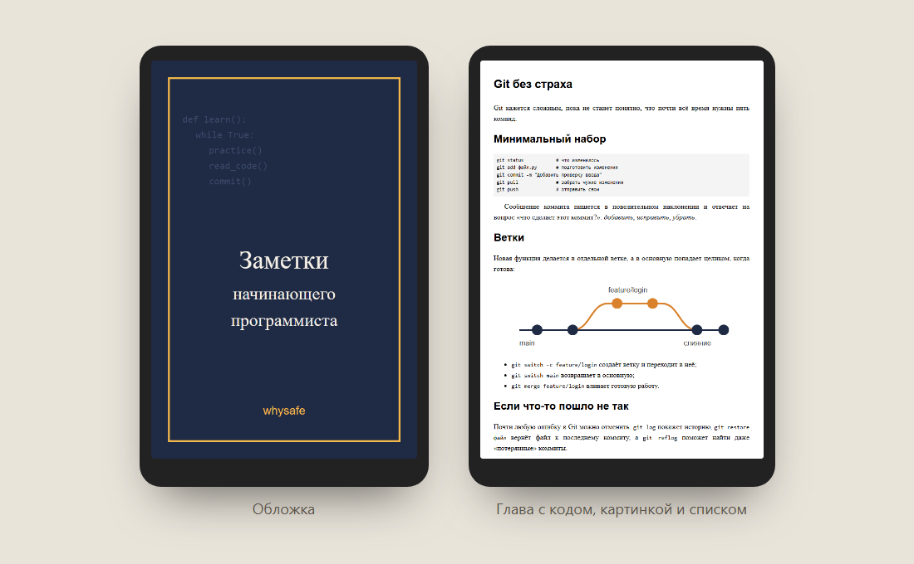

# epubnik: Markdown-главы в книгу EPUB 3

Консольная утилита, которая собирает электронную книгу из папки с главами в Markdown: с обложкой, оглавлением, картинками и сносками. Готовый файл соответствует стандарту EPUB 3, проходит официальный валидатор W3C epubcheck без ошибок и предупреждений и поэтому открывается в обычных читалках и приложениях для книг. Только стандартная библиотека Python, без зависимостей.




Пример собранной книги лежит в [`examples/zametki.epub`](examples/zametki.epub), исходники к ней в [`examples/zametki`](examples/zametki).

## Как пользоваться

```text
$ epubnik new moya-kniga
Шаблон книги создан в moya-kniga. Соберите: epubnik build moya-kniga

$ epubnik build examples/zametki
examples/zametki.epub: глав 3, картинок 2, пунктов оглавления 12, 8.6 КБ

$ epubnik check examples/zametki.epub
examples/zametki.epub: ok
```

Папка книги:

```
moya-kniga/
  book.toml        название, автор, язык, обложка, порядок глав
  01-start.md      главы: по алфавиту или в порядке из book.toml
  02-dalshe.md
  img/cover.png    картинки рядом с главами, пути относительные
```

```toml
title = "Заметки начинающего программиста"
author = "whysafe"
language = "ru"
description = "Три короткие главы о том, с чего начать"
date = "2026-10-22"
cover = "img/cover.svg"
chapters = ["01-privychki.md", "02-git.md", "03-chuzhoy-kod.md"]
```

## Возможности

**Markdown**
- Заголовки, абзацы, *курсив*, **жирный**, `код` и блоки кода с языком, вложенные списки, цитаты, ссылки, горизонтальная линия, перенос строки.
- Картинки копируются в книгу, ссылки на них переписываются. Внешние картинки по URL остаются ссылками.
- Сноски `[^1]` нумеруются по порядку появления и собираются в конце главы со ссылкой назад. Читалки показывают их во всплывающем окне благодаря `epub:type="noteref"`.
- `snake_case` и `__init__` не превращаются в курсив, HTML в тексте экранируется.

**Книга**
- EPUB 3 с документом оглавления `nav.xhtml` и `toc.ncx` для старых читалок EPUB 2.
- Оглавление строится из заголовков: главы и вложенные в них разделы. Якоря транслитерируются в латиницу (`#git-bez-strakha`), потому что не все читалки понимают кириллицу во фрагментах ссылок.
- Обложка как `cover-image` и отдельная страница. Поддерживаются PNG, JPEG, GIF, SVG и WebP.
- Аккуратная типографика по умолчанию: абзацный отступ, выключка по ширине, код с переносом строк.
- Воспроизводимая сборка: одни и те же исходники дают байт-в-байт одинаковый файл. Время берётся из `date` в book.toml или из `SOURCE_DATE_EPOCH`.

**Проверка**
- `epubnik check` проверяет то, на чём чаще всего ломаются читалки: mimetype первым и без сжатия, container.xml, обязательные метаданные, файлы из манифеста и лишние файлы, spine, наличие оглавления и корректность XHTML.
- Понятные ошибки в исходниках: «Глава nope.md из book.toml не найдена», «02-git.md: картинка schema.png не найдена».

## Установка

```bash
pip install git+https://github.com/whysafe/epubnik
# или без установки, из папки репозитория:
python -m epubnik build examples/zametki
```

## Как устроено

```
epubnik/markdown.py   разбор Markdown в XHTML, заголовки для оглавления, картинки, сноски
epubnik/builder.py    book.toml, сборка OPF, nav, NCX, обложки и ZIP-контейнера
epubnik/check.py      проверка структуры готового .epub
epubnik/cli.py        команды new, build, check
```

- Строчная разметка разбирается через заглушки: код, ссылки и картинки сначала вырезаются, чтобы `*` и `_` внутри них не стали курсивом, затем текст экранируется, и только потом применяются жирный и курсив.
- По стандарту OCF файл `mimetype` должен идти первым и без сжатия. Остальные файлы пишутся в отсортированном порядке с одинаковой датой, поэтому архив воспроизводим.
- Идентификатор книги — UUID v5 от названия и автора: он не меняется между сборками, и читалки не считают новую версию другой книгой.

## Тесты

```bash
pip install pytest
pytest
```

29 тестов: вся разметка Markdown, экранирование, вложенные списки, сноски, якоря, метаданные и spine, оглавление, перенос картинок, воспроизводимость сборки, ошибки в исходниках, проверка битых архивов и CLI. В GitHub Actions тесты идут на Python 3.11–3.13. Отдельная задача собирает пример и шаблон книги и прогоняет их через официальный epubcheck с флагом `--failonwarnings`.

## Автор

whysafe · [whysafe.ru](https://whysafe.ru) · Telegram [@yawhysafe](https://t.me/yawhysafe) · канал [@whysafe_official](https://t.me/whysafe_official) · [Kwork](https://kwork.ru/user/whysafe) · hello@whysafe.ru

## Лицензия

MIT
