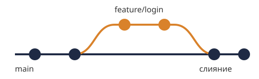

# Git без страха

Git кажется сложным, пока не станет понятно, что почти всё время нужны пять команд.

## Минимальный набор

```bash
git status            # что изменилось
git add файл.py       # подготовить изменения
git commit -m "Добавить проверку ввода"
git pull              # забрать чужие изменения
git push              # отправить свои
```

Сообщение коммита пишется в повелительном наклонении и отвечает на вопрос «что сделает этот коммит?»: *добавить*, *исправить*, *убрать*.

## Ветки

Новая функция делается в отдельной ветке, а в основную попадает целиком, когда готова:



- `git switch -c feature/login` создаёт ветку и переходит в неё;
- `git switch main` возвращает в основную;
- `git merge feature/login` вливает готовую работу.

## Если что-то пошло не так

Почти любую ошибку в Git можно отменить. `git log` покажет историю, `git restore файл` вернёт файл к последнему коммиту, а `git reflog` поможет найти даже «потерянные» коммиты.
